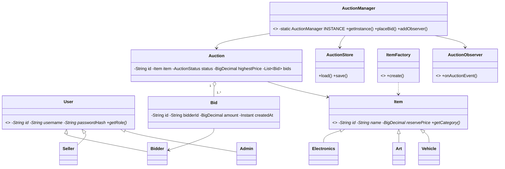

# Sơ đồ lớp

Ghi chú: `AuctionManager` Singleton giúp thống nhất trạng thái trong một tiến trình server. `ReentrantLock` theo từng phiên bảo vệ thao tác đặt giá. `AuctionObserver` là điểm mở rộng để server thông báo sự kiện cho các client; starter hiện chưa triển khai push event qua kết nối client đang mở.
