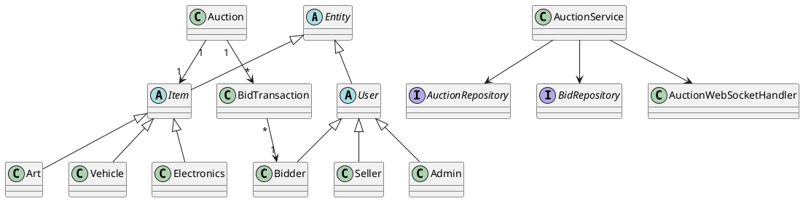

# Sơ đồ lớp (PlantUML)

Ghi chú: starter code hiện lưu `UserAccount` và `Item` dưới dạng entity JPA đơn giản để giảm độ phức tạp mapping. Nhóm có thể chuyển thành hierarchy `User`/`Bidder`/`Seller`/`Admin` và `Item`/`Electronics`/`Art`/`Vehicle` để thể hiện Inheritance/Polymorphism rõ hơn trong rubric, nếu triển khai đầy đủ và có ý nghĩa.
